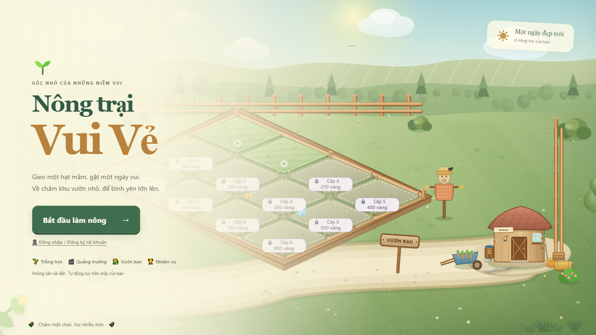
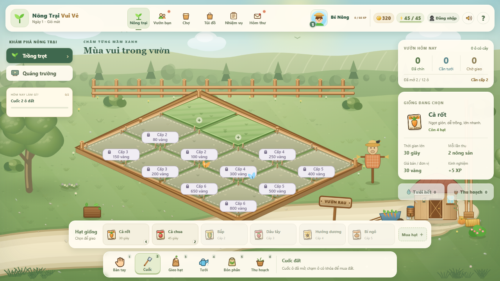
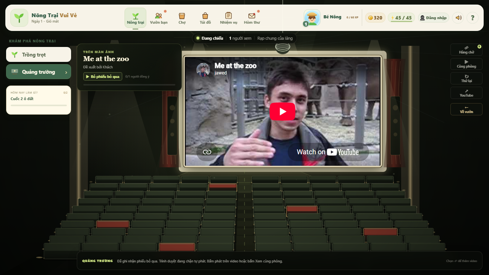
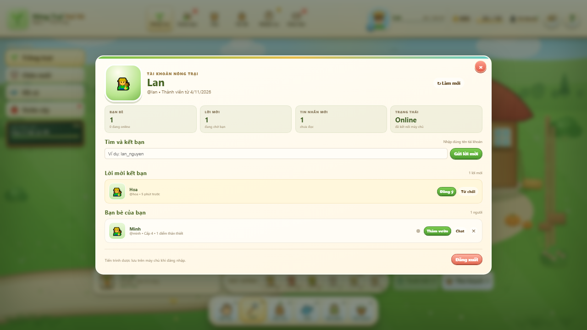
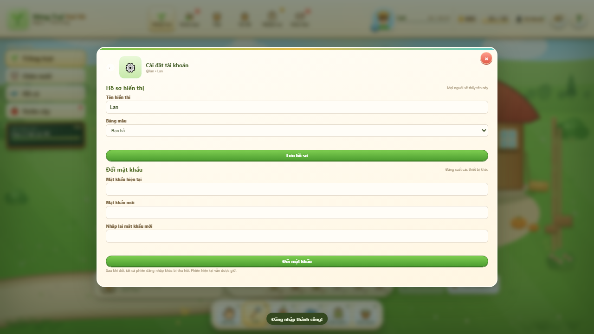
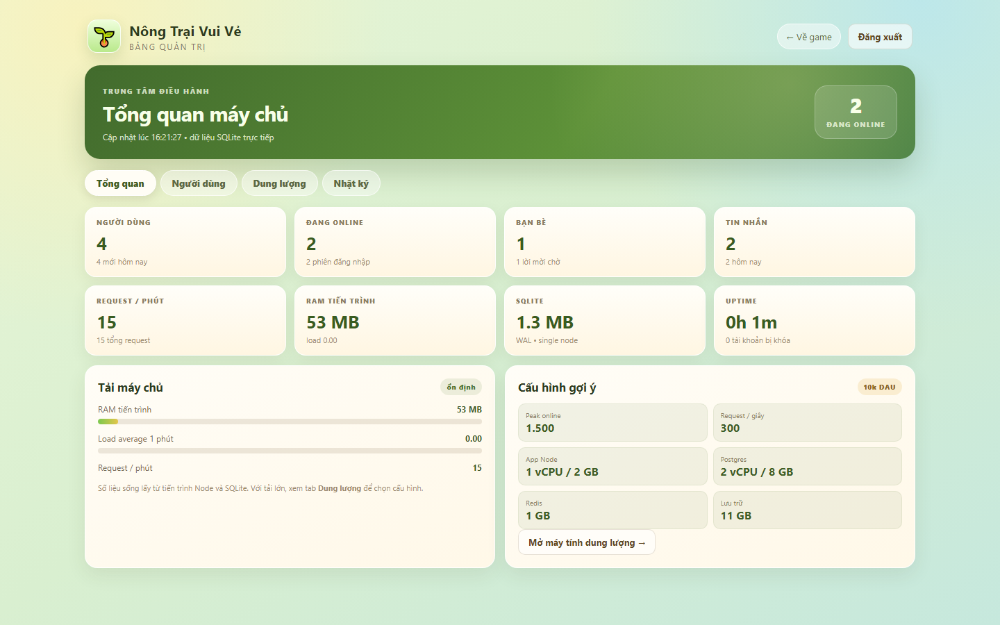
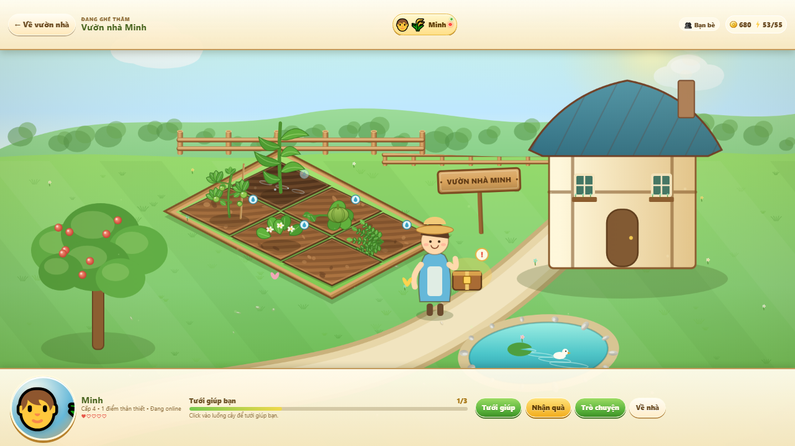

# 🌾 Nông Trại Vui Vẻ — Tuổi thơ trở lại

Một bản dựng lại fan-made của tựa game nông trại tuổi thơ, lấy cảm hứng từ hai ảnh chụp bạn gửi và lối chơi của *Nông Trại Vui Vẻ / Farm Day* ngày xưa.

> Mã nguồn: **https://github.com/kducanh/nong-trai-vui-ve**

Lần cập nhật này tập trung vào **Trồng trọt**, **Quảng trường** và **Vườn bạn**. Ba khu **Chăn nuôi · Hồ cá · Vườn cây** đang được **tạm ẩn** để hoàn thiện ở giai đoạn sau; code vẫn được giữ nguyên, chỉ ẩn khỏi giao diện.





---

## ▶️ Chơi ngay

**http://127.0.0.1:8123/**

Game giờ cần **máy chủ Node.js** để đăng nhập, kết bạn và lưu tiến trình. Không còn dùng `python -m http.server` cho bản đầy đủ. Chạy:

```bash
cd F:\nongtrai
node server.mjs
```

rồi mở `http://127.0.0.1:8123/`.

Hoặc dùng npm:

```bash
npm start
# terminal khác
npm run seed:demo
```

Không cần `npm install` vì server chỉ dùng module có sẵn của Node. Yêu cầu **Node.js 22.13+** (khuyến nghị Node 24).

Muốn người khác trong cùng mạng LAN truy cập, chạy với `HOST=0.0.0.0` (Windows: `set HOST=0.0.0.0` trước khi chạy) và mở firewall cho cổng 8123. Khi đưa lên Internet, hãy đặt sau HTTPS/reverse proxy.

Lần chạy đầu tiên, server tự tạo tài khoản admin và ghi mật khẩu vào `server/data/admin-credentials.txt` (file này đã nằm trong `.gitignore`, không đưa lên GitHub). Có thể đặt mật khẩu admin qua biến môi trường:

```bash
set ADMIN_PASSWORD=MatKhauManhCuaBan
node server.mjs
```

Sau khi server chạy, tạo dữ liệu demo (chỉ cần một lần):

```bash
npm run seed:demo
```

### Tài khoản demo
| Tài khoản | Mật khẩu | Ghi chú |
|---|---|---|
| `lan` | `Demo@12345` | Có bạn thật là Minh, có tin nhắn mẫu |
| `minh` | `Demo@12345` | Bạn của Lan |
| `hoa` | `Demo@12345` | Đang gửi lời mời kết bạn cho Lan |
| `admin` | Xem `server/data/admin-credentials.txt` | Quản trị — **đổi mật khẩu trước khi dùng thật** |

> Đây là tài khoản demo trên máy cục bộ. Không dùng mật khẩu này cho môi trường thật. Khi clone repo mới, chạy `npm run seed:demo` để tạo Lan/Minh/Hoa.

---

## 🧭 Giao diện mới

### Thanh menu chính
`Nông trại` · `Vườn bạn` · `Chợ` · `Túi đồ` · `Nhiệm vụ` · `Hòm thư`

Mỗi mục mở một khu vực riêng, không còn dồn hết lên màn hình chính.

### Cột khu vực trong Nông trại
`Trồng trọt` · `Quảng trường`

- **Trồng trọt** là trang mặc định, chỉ có ruộng rau, nhà dụng cụ, bù nhìn và các luống đất.
- **Quảng trường** là rạp chiếu tối kiểu 3D dùng chung hàng đợi YouTube.
- **Chăn nuôi, Hồ cá, Vườn cây** đang **tạm ẩn**; mã nguồn vẫn còn để mở lại ở giai đoạn sau.
- Thẻ **“Việc đang làm”** bên trái luôn nhắc mục tiêu tiếp theo; bấm vào để mở Nhiệm vụ.

---

## 🌱 Trồng trọt

- 12 ô đất isometric, 6 loại cây: cà rốt, cà chua, bắp, dâu tây, hướng dương, bí ngô.
- Ván mới có **2 ô đất miễn phí**, chưa cuốc. Mỗi ô còn lại cần **đủ cả cấp độ và vàng**, ghi trực tiếp trên ô khóa.
- Cấp 2: hai ô giá **80 / 100 vàng**; cấp 3: **150 / 200**; cấp 4: **250 / 300**; cấp 5: **400 / 500**; cấp 6: **650 / 800**. Lên cấp cho phép mua đất, không tự mở miễn phí.
- Click ô khóa hoặc **Mở đất +** → xem cấp yêu cầu, giá và số vàng còn lại → xác nhận mua. Nút Mở đất gợi ý ô có cấp yêu cầu thấp nhất. Mỗi ô chỉ trả tiền một lần; mở đất không tốn năng lượng. Sau đó dùng Cuốc để tạo luống.
- Chuỗi nhiệm vụ đầu là cuốc 2 ô → gieo 2 cà rốt → tưới 2 ô → thu hoạch 2 cây; nhận thưởng mỗi bước để lên cấp 2 ngay từ hai ô ban đầu.
- Ô đã mở được lưu cùng tiến trình trên máy/tài khoản. Bản lưu cũ vẫn giữ các ô đã cuốc hoặc có cây, không cần chơi lại.
- Chọn **Cuốc** → click ô cỏ để khai hoang.
- Chọn gói hạt ở thanh dưới → click ô đất để gieo.
- Tưới nước giúp cây lớn nhanh hơn; bón phân tăng thêm 1 nông sản khi thu hoạch.
- **Thẻ giống đang chọn** hiển thị thời gian lớn, giá bán và số hạt còn lại.
- **Tưới hết**: tưới mọi ô đang khát (mỗi ô 1 năng lượng).
- **Thu hoạch**: thu hoạch tất cả cây đã chín.
- Khi cây chín, click trực tiếp lên cây hoặc dùng nút Thu hoạch.

---

## 🐄 Chăn nuôi · 🎣 Hồ cá · 🌳 Vườn cây — tạm ẩn

Ba khu vực này đã được gỡ khỏi thanh điều hướng ở giai đoạn hiện tại để tập trung vào Trồng trọt, Quảng trường và Vườn bạn. Code cảnh, logic và API vẫn được giữ trong `assets/areas.js`, `assets/game.js` để mở lại sau. Các nhiệm vụ ngày và chuỗi nhiệm vụ liên quan cũng đã được thay bằng nhiệm vụ làm vườn để không bị kẹt.

---

## 👩‍🌾 Vườn bạn

Mở **Vườn bạn** trên thanh menu để ghé thăm vườn của 3 người bạn mẫu: **Lan**, **Minh** và **Bà Tư**.

- Mỗi người có khu vườn, ngôi nhà và màu sắc riêng.
- **Click vào luống cây** để tưới giúp bạn — tối đa 3 luống/người/ngày.
- Mỗi lần tưới nhận **+10 vàng, +4 XP** và tăng điểm thân thiết.
- **Nhận quà** mỗi ngày một lần từ mỗi người bạn.
- **Trò chuyện** để nghe lời nhắn và xem bong bóng hội thoại.
- Có thể chuyển nhanh giữa các vườn bằng các tab bạn bè ở trên.
- Trạng thái đã tưới, quà đã nhận và điểm thân thiết được lưu lại theo ngày.

> Khi chưa đăng nhập, game dùng 3 hàng xóm mẫu. Khi đăng nhập, danh sách bạn được lấy từ máy chủ: tìm theo tên tài khoản, gửi/nhận lời mời, thấy online và thăm vườn thật.

---

## 🎬 Quảng trường — xem YouTube cùng nhau

Mở **Quảng trường** ở cột bên trái để vào rạp chiếu tối kiểu **wetube ciné 3D**: phòng tối, màn chiếu viền vàng, 100 ghế phối cảnh, đèn lối đi, quả cầu disco và các tia laser. Giao diện lấy cảm hứng từ dự án [wetube-cine-3d](https://github.com/kducanh/wetube-cine-3d) của tác giả.

- Mọi người trong cùng phòng dùng **một hàng đợi và một mốc thời gian phát**.
- Dán liên kết hoặc mã video YouTube vào ô nhập; server chỉ nhận **11 ký tự ID** hợp lệ.
- Hàng đợi tối đa **20 video**; video đầu phát ngay, các video sau xếp hàng.
- **Bỏ qua** cần đa số người đang xem bỏ phiếu; phiếu tự mất khi người đó rời phòng.
- Người xem được đếm theo presence 15 giây; khách vẫn vào được, tài khoản đăng nhập hiện tên người đề xuất.
- Nếu video chặn nhúng, giao diện báo lỗi và cho **mở trên YouTube** hoặc thử video khác.
- Hàng đợi nằm trong RAM server, sẽ reset khi restart server. Chưa có chat riêng trong quảng trường.
- YouTube có thể chặn autoplay; bấm **Xem cùng phòng** hoặc nút phát trên iframe.



---

## 👤 Tài khoản & kết nối bạn bè thật

Bấm **Đăng nhập** trên thanh trên cùng (hoặc nút tài khoản ở màn hình bắt đầu).

- Đăng ký / đăng nhập bằng tên tài khoản và mật khẩu.
- Mật khẩu được băm bằng **scrypt** trên máy chủ; session dùng cookie `HttpOnly`.
- Tiến trình game được lưu lên máy chủ khi đăng nhập, đồng bộ giữa các lần chơi.
- Tìm bạn bằng tên tài khoản, gửi và nhận lời mời kết bạn.
- Khi đã là bạn: thấy trạng thái online/offline, **thăm vườn thật**, tưới giúp, nhận quà, chat.
- Tin nhắn lưu trên máy chủ; người nhận thấy chấm đỏ và số tin chưa đọc.
- **Cài đặt tài khoản**: đổi tên hiển thị, bảng màu, đổi mật khẩu; đổi mật khẩu sẽ thu hồi các phiên ở thiết bị khác.
- Khách vẫn chơi được, nhưng chỉ lưu trên máy và dùng 3 hàng xóm mẫu.

Lần đầu đăng nhập, tiến trình đang chơi trên máy sẽ được tải lên tài khoản. Những lần sau, tiến trình trên máy chủ được tải về.





---

## 🛡️ Trang quản trị

Mở **http://127.0.0.1:8123/admin.html** và đăng nhập bằng tài khoản `admin`.

- Tổng quan: người dùng, đang online, bạn bè, tin nhắn, request/phút, RAM, uptime, dung lượng SQLite.
- Người dùng: tìm kiếm, phân trang, cấp/hạ quyền admin, khóa/mở khóa, đặt lại mật khẩu tạm, xóa tài khoản.
- Dung lượng: máy tính theo DAU, tỷ lệ online cùng lúc, request/người/phút; bảng tham chiếu 1k → 5M DAU.
- Nhật ký: các thao tác quản trị (khóa, phân quyền, reset mật khẩu).

Admin không thể tự khóa hoặc tự hạ quyền chính mình; hệ thống luôn giữ ít nhất một admin.



---

## 🖥️ Server & dung lượng

- Server: Node.js thuần, SQLite WAL, không cần framework.
- API: tài khoản, session, bạn bè, lời mời, chat, state game, admin.
- Dữ liệu: `server/data/nongtrai.db`.
- Tài khoản admin: `server/data/admin-credentials.txt`.
- Báo cáo tính toán chi tiết: **[docs/server-capacity.md](docs/server-capacity.md)**.
- Công cụ tính trong admin: tab **Dung lượng** hoặc API  
  `GET /api/admin/capacity?dau=100000&concurrency=0.12&req=15`.

Tóm tắt nhanh: bản hiện tại phù hợp **1k–10k DAU** trên một VPS nhỏ; **100k DAU** cần tách app + Postgres + Redis + CDN; **1M DAU** cần cluster app, Postgres replica, Redis, WebSocket và đội vận hành; **5M DAU** là bài toán multi-region/sharding.

---

## 🎮 Điều khiển

| Thao tác | Tác dụng |
|---|---|
| Click / chạm | Chọn ô đất, cây trồng, đất khóa, bạn bè |
| `1` … `6` | Bàn tay, Cuốc, Gieo hạt, Tưới, Bón phân, Thu hoạch |
| `S` | Mở Chợ |
| `B` | Mở Túi đồ |
| `Q` | Mở Nhiệm vụ |
| `M` | Mở Hòm thư |
| `H` | Mở sổ tay hướng dẫn |
| `Esc` | Đóng bảng / về vườn rau |

---

## 🖼️ Ảnh xem trước

| Vườn bạn | Quảng trường |
|---|---|
|  |  |

---

## 📁 Cấu trúc

```
F:\nongtrai
├── index.html          # khung game + menu + HUD + các bảng
├── admin.html          # trang quản trị riêng
├── server.mjs          # HTTP server + API + SQLite
├── README.md
├── docs
│   └── server-capacity.md
├── server
│   ├── plaza.mjs       # hàng đợi + đồng hồ phát chung
│   ├── seed-demo.mjs
│   └── data
│       ├── nongtrai.db
│       └── admin-credentials.txt
├── tests
│   ├── land.test.mjs
│   ├── plaza.test.mjs
│   └── plaza-client.test.mjs
├── assets
│   ├── style.css       # giao diện, menu, bảng, vườn bạn
│   ├── theme.css       # bảng màu, bố cục trồng trọt, giao diện mở đất
│   ├── land.js         # giá đất, quyền sở hữu và chuyển đổi bản lưu cũ
│   ├── plaza.js        # quảng trường YouTube phía client
│   ├── plaza-cinema.js # nền rạp 2.5D (ghế, đèn, màn chiếu)
│   ├── plaza.css
│   ├── plaza-night.svg
│   ├── account.css     # tài khoản, bạn bè, chat
│   ├── admin.css       # giao diện quản trị
│   ├── art.js          # cảnh tĩnh của nông trại
│   ├── sprites.js      # cây trồng, con vật, icon, hiệu ứng
│   ├── friend.js       # vẽ cảnh vườn bạn bè
│   ├── areas.js        # vẽ cảnh chuồng thú, hồ cá, vườn táo
│   ├── audio.js        # nhạc nền + SFX tổng hợp
│   ├── game.js         # luật chơi, submenu, tương tác, lưu game
│   ├── account.js      # đăng nhập, bạn bè, chat, đồng bộ save
│   ├── admin.js        # dashboard quản trị
│   └── favicon.svg
└── screenshots
    ├── start.png
    ├── farm.png
    ├── unlock-land.png
    ├── friends.png
    ├── plaza.png
    ├── account.png
    ├── account_settings.png
    ├── admin_overview.png
    ├── admin_users.png
    └── admin_capacity.png
```

---

## 🔧 Ghi chú kỹ thuật

- Frontend vanilla JavaScript, không cần build; backend Node.js thuần + SQLite, không cần framework.
- Kiểm thử: `npm test` (đất đai, hàng đợi quảng trường, URL YouTube).
- Quảng trường dùng guest cookie ký HMAC, rate limit và hàng đợi RAM; không lưu lịch sử video.
- `Referrer-Policy` của `index.html` được nới thành `strict-origin-when-cross-origin` để iframe YouTube hoạt động.
- Canvas 2D cho cảnh nông trại, vườn bạn và ba khu vực; cảnh tĩnh của nông trại được cache.
- Khách: trạng thái lưu vào `localStorage` với khóa `nongtrai.vui.ve.save.v1`.
- Đăng nhập: trạng thái đồng bộ lên SQLite qua API, có debounce khi lưu.
- Mật khẩu dùng scrypt + salt riêng; session cookie `HttpOnly`, `SameSite=Lax`.
- Cây, vật nuôi, hòm thư, năng lượng và vườn bạn đều dùng timestamp thực để tiếp tục khi mở lại.
- Tham số tiện ích: `?play=1` vào thẳng game, `?fresh=1` xem ván mới tinh.
- Đây là sản phẩm **fan-made** gợi lại ký ức tuổi thơ, không liên kết với nhà phát hành game gốc và không dùng tài nguyên của game gốc.

### Nguồn cảm hứng

- Hai ảnh chụp màn hình do bạn cung cấp.
- Bài giới thiệu *Game Nông Trại Vui Vẻ ngày xưa* trên FPT Shop:  
  https://fptshop.com.vn/tin-tuc/giai-tri/game-nong-trai-vui-ve-ngay-xua-173869

---

Chúc bạn có những phút giây thật bình yên bên khu vườn nhỏ. 🌻
